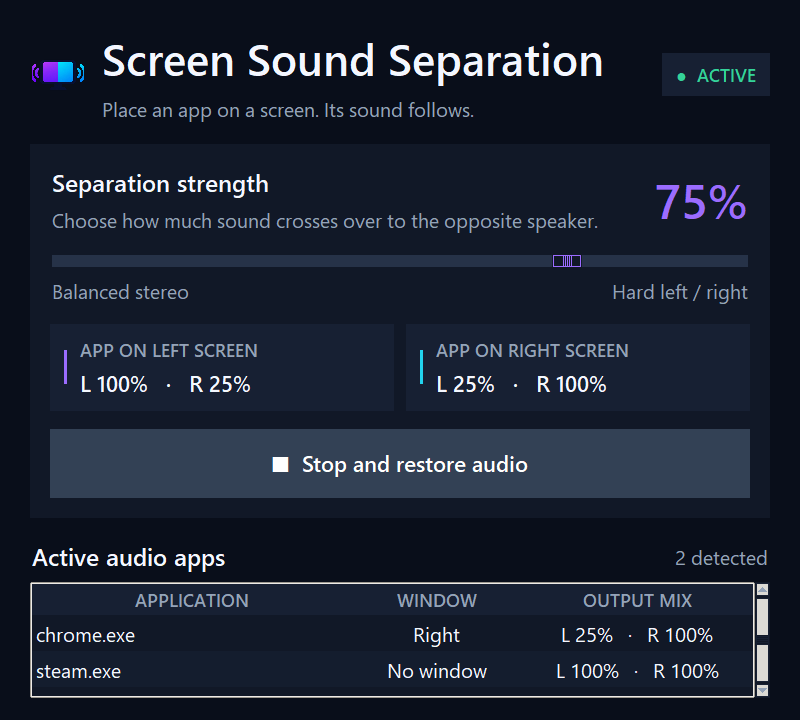

# Screen Sound Separation

A small Windows app that pans each application's audio toward the monitor where
its main window is located. Put a browser on the left display and its sound leans
left; move it to the right display and it follows. A single slider controls how
strongly the two sides are separated.



## Prototype features

- Detects the largest visible window for every active audio process.
- Updates routing once per second as windows move between monitors.
- Offers a 0–100% separation control, from normal stereo to hard left/right.
- Preserves each audio session's existing level and restores its original
  channel balance when routing stops or the app closes.
- Leaves background audio and processes without visible windows centered.
- Uses a native Windows identity and bundled icon instead of the Python taskbar
  icon.
- Prevents multiple router instances from competing over the same audio sessions.

## Run it

Requirements: Windows 10/11 and Python 3.11 or newer.

```powershell
.\run.ps1
```

The first run creates a local virtual environment and installs the three small
Windows audio dependencies. Click **Start routing**, play audio in two apps, and
place their windows on different monitors.

For development:

```powershell
py -m venv .venv
.\.venv\Scripts\python -m pip install -r requirements-dev.txt
.\.venv\Scripts\python -m pytest
```

## Project layout

The code is deliberately split into a few small modules:

- `app.py` builds the window and refreshes it once per second.
- `audio.py` reads and adjusts Windows audio sessions.
- `windows.py` finds displays, windows, and their process IDs.
- `routing.py` contains the testable left/right mixing calculation.
- `assets/` contains the PNG and multi-resolution Windows icon used by the app.

Start with `routing.py` if you are new to the project; it has no Windows API or
UI code. The tests in `tests/` show the expected behaviour with concrete values.

## How it works

Windows exposes each application's audio session through Core Audio. The app
matches a session's process ID to its largest visible top-level window, maps the
window's horizontal position across the virtual desktop, and applies independent
left/right channel gains. It changes balance, not the selected audio device.

## Prototype limitations

- Windows only; the current implementation uses Core Audio and Win32 APIs.
- Apps that play audio in a background process may not map to their visible UI.
- A single process with windows on multiple monitors follows its largest window.
- Mono endpoints and sessions with fewer than two channels are ignored.
- This is per-app panning on one stereo output, not routing to separate physical
  output devices. A virtual audio driver would be required for that version.

## Safety

The app changes per-channel balance multipliers, not the normal Windows app-volume
control. It sets both multipliers back to `1.0` when you stop routing or close the
window. Shutdown cleanup also runs if the event loop exits unexpectedly or the app
receives a console interrupt. If the process is force-killed, the next launch
repairs any stale balance before routing starts.
